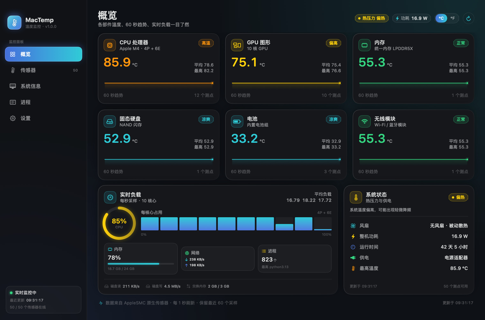
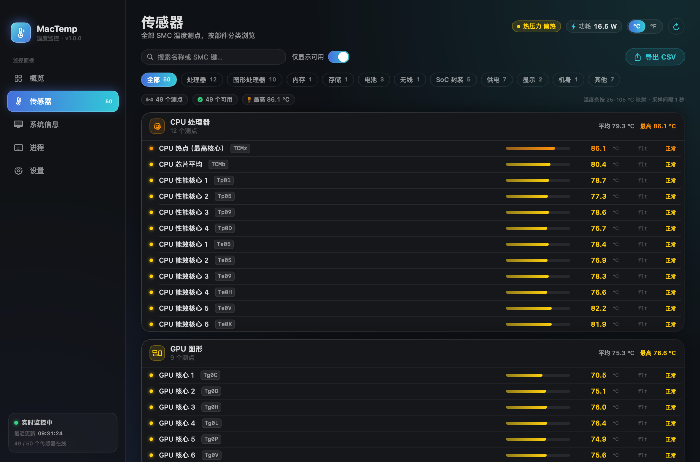
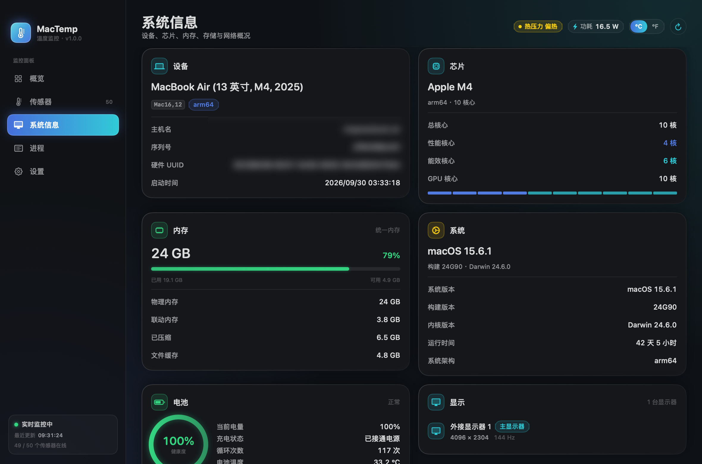
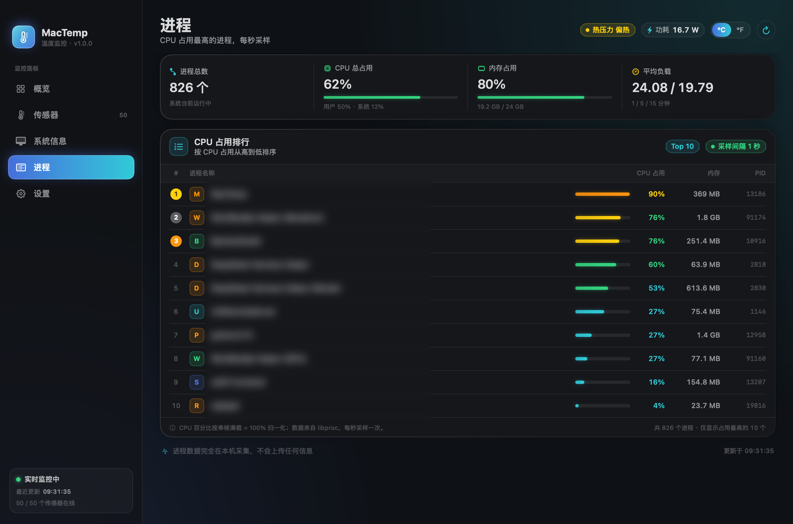
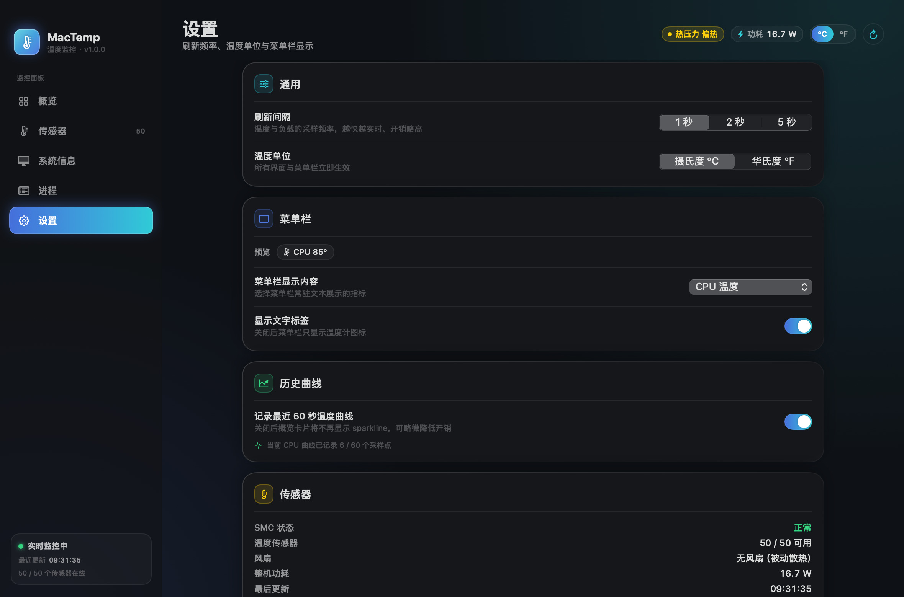
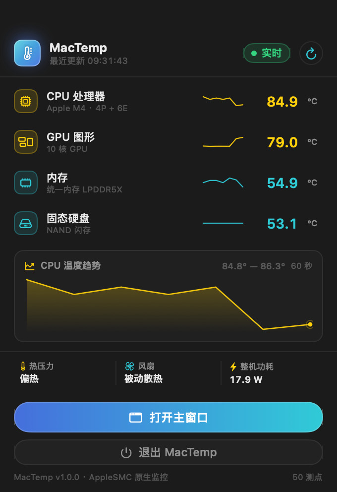
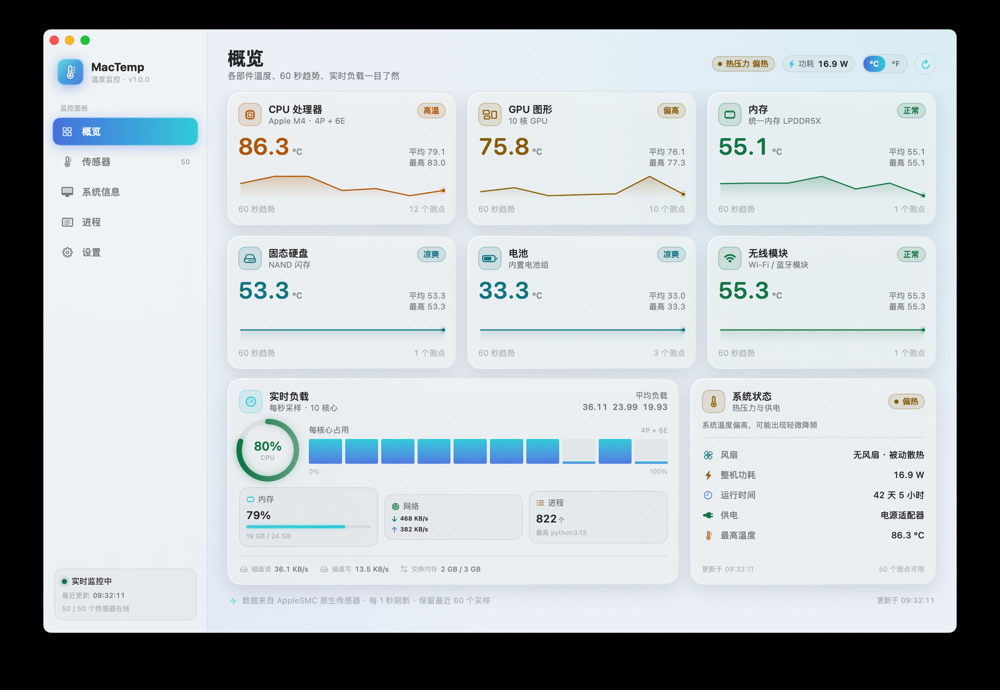

# MacTemp · macOS 温度与系统监控

AIDA64 风格的 macOS 原生硬件监控应用：直接读取 Apple Silicon 的 **SMC 传感器**，实时显示
CPU / GPU / 内存 / 固态硬盘 / 电池 / 无线模块等各个部件的温度，并附带整机功耗、热压力、风扇、
实时负载、系统信息与进程列表。菜单栏常驻，随时瞄一眼温度。

- 原生 SwiftUI 应用，无 Electron、无第三方依赖
- 直接通过 IOKit 与 AppleSMC 通信，**无需 sudo、无需安装内核扩展、无需关闭 SIP**
- 纯本地运行，不联网、不上传任何数据
- 中文界面，深色科技感，自适应浅色模式



## 功能

| 页面 | 内容 |
|---|---|
| **概览** | 六大部件温度卡片（CPU/GPU/内存/固态硬盘/电池/无线）、60 秒历史曲线、热压力、风扇、整机功耗、最高温度、CPU 每核占用、内存/网络/磁盘 IO/交换内存实时负载 |
| **传感器** | 50 个实测校准过的温度传感器，按部件分组；支持搜索、分类筛选、仅显示可用、导出 CSV；显示 SMC 原始键名与数据类型 |
| **系统信息** | 机型、芯片、P/E 核心与 GPU 核心、内存明细、macOS 版本、显示器、磁盘容量、网络接口、电池健康（健康度环/循环次数/温度） |
| **进程** | 按 CPU 占用排序的进程列表、内存占用、进程总数 |
| **设置** | 刷新间隔（1/2/5 秒）、摄氏度/华氏度、菜单栏显示项、显示文字标签、60 秒历史曲线开关、传感器状态与重新扫描 |

菜单栏可显示 CPU 温度 / GPU 温度 / 最高部件温度 / 整机功耗 / 风扇转速，点击展开迷你面板
（含 4 个主部件温度、CPU 60 秒趋势、热压力、风扇、功耗与快捷操作）。

| 传感器 | 系统信息 |
|---|---|
|  |  |

| 进程 | 设置 |
|---|---|
|  |  |

菜单栏面板：



实际运行窗口（浅色模式）：



## 系统要求

- **Apple Silicon Mac**（M1 / M2 / M3 / M4 / M5 系列），macOS 14 Sonoma 或更高
- Intel Mac 不支持（本项目只实现了 Apple Silicon 的 SMC 传感器读取与键表）
- 无需管理员权限

## 安装与运行

方式一（推荐）：解压 `dist/MacTemp-1.0.0.zip`，把 `MacTemp.app` 拖到「应用程序」目录，双击打开。

方式二：直接运行 `dist/MacTemp.app`（或终端 `open dist/MacTemp.app`）。

由于应用使用 ad-hoc 签名（没有 Apple 开发者证书），首次打开若提示「无法验证开发者」，请：

- 在「系统设置 → 隐私与安全性」中点「仍要打开」，或
- 右键点击 App → 打开，或终端执行：

```bash
xattr -dr com.apple.quarantine dist/MacTemp.app
open dist/MacTemp.app
```

启动后主窗口显示温度概览，菜单栏出现「🌡 CPU 87°」读数。关闭窗口应用仍常驻菜单栏；
点 Dock 图标或菜单栏面板里的「打开主窗口」可重新显示。

> 卸载：退出应用后把 `MacTemp.app` 拖入废纸篓即可。不写系统目录、不装后台服务、不修改系统设置。

## 从源码构建

只需要 **Command Line Tools**（不需要完整 Xcode）：

```bash
cd MacTemp
bash scripts/build.sh      # 产物：dist/MacTemp.app
bash scripts/package_release.sh  # 产物：dist/MacTemp-1.0.0.zip（用于 GitHub Release 附件）
```

构建脚本会：编译 C 桥接层 → 编译全部 Swift 源码 → 生成 App 图标 → 组装 `.app` Bundle → ad-hoc 签名。

> 仓库只包含源码与截图，不提交 `build/` 与 `dist/`（见 `.gitignore`）。
> 分发包可在 GitHub Releases 页面下载，或按上面的命令自行构建。

命令行自测（不开窗口，验证 SMC / 采集器 / 聚合逻辑）：

```bash
dist/MacTemp.app/Contents/MacOS/MacTemp --selftest
```

离屏渲染界面截图（开发/验收用，无窗口弹出）：

```bash
dist/MacTemp.app/Contents/MacOS/MacTemp --render /tmp/mac_temp_shots
```

## 温度传感器说明

MacTemp 通过 IOKit 打开 `AppleSMC` 用户客户端，枚举全部 SMC 键，再按机型匹配传感器目录。
M4 MacBook Air 上共枚举到 **2148 个 SMC 键 / 186 个温度候选键**，其中**真正独立的传感器约 50 个**，
其余是同一物理传感器的多校准别名（SMC 里普遍存在恒定 7.1°C / 6.7°C 温差的重复键）、占位键或
不可解码类型。应用使用实测校准的白名单，因此不会出现「同一颗核心 3 个几乎一样的温度」。

| 部件 | 主指标（SMC 键） | 说明 |
|---|---|---|
| CPU | `TCMz` CPU 热点 | 另显示 4 个性能核 + 6 个能效核逐核温度（`Tp*` / `Te*`）、`TCMb` 芯片平均 |
| GPU | `Tg0D` | 10 个 GPU 核心测点取平均/最高 |
| 内存 | `Tm0B` | 统一内存 LPDDR5X |
| 固态硬盘 | `TH0x` | NAND 闪存 |
| 电池 | `TB0T` | 另两枚电芯 `TB1T`/`TB2T`，并与 IOKit 电池健康信息交叉校准 |
| 无线 | `TW0P` | Wi-Fi / 蓝牙模块 |
| SoC 封装 | `TPMP` | 另有封装测点 `TPSP/TSCD/TPD*` |
| 供电 VRM | `TVV0` | 另有 `TVM0` 等供电域测点 |
| 屏幕 / 机身 | `TDBP` / `TAOL` | 屏幕背光/面板、机身环境温度 |

技术细节：

- Apple Silicon 上 SMC 的 `flt` 类型为**小端浮点**（部分开源实现会按大端解码得到天文数字，
  本应用已在 M4 MacBook Air + macOS 15.6.1 上实测校准）；`sp/fp` 前缀的定点类型为大端
- 按部件设置合理温度区间过滤毛刺（GPU 键偶发 -4.5°C / 0.1°C 的无效读数会被丢弃；
  电池传感器上限 60°C；`Ta0*`/`Tz*` 等占位键被排除）
- 无风扇机型（MacBook Air）显示「无风扇 · 被动散热」；MacBook Pro / Mac mini 等带风扇机型
  会自动读取 `F0Ac/F1Ac` 转速
- 不同机型暴露的传感器键不同：没有的传感器不会编造数值，只展示真实读到的值
- 传感器键名语义与校准依据见 `docs/SENSOR_MAP.md`（含六阶段实测证据、P/E 核归属推导、
  交叉验证与不确定性说明）

## 常见问题

**为什么温度数值比手摸的高很多？**
SMC 测的是芯片内部/基板温度，会明显高于机身表面。无风扇 MacBook Air 在持续负载下 CPU 热点
90–100°C 属于正常范围，系统会自动调节频率。

**为什么有些部件没有温度？**
不同机型传感器不同，部分机型没有独立的内存或 NAND 传感器。应用只展示真实读到的值。

**会影响续航吗？**
默认 1 秒刷新，实测常驻约 **0.8–1.6% CPU、约 120MB 内存**；可在设置中改成 2/5 秒刷新。

**需要什么权限？**
不需要管理员权限。读取 SMC 与硬件信息都是普通用户可用的公开 IOKit 接口。

## 技术实现

- 语言：Swift 5（SwiftUI + AppKit），部署目标 macOS 14
- SMC：C 桥接层实现 AppleSMC 用户客户端协议（selector 2，READ_KEYINFO / READ_BYTES / READ_INDEX），
  Swift 侧负责解码、传感器目录匹配、按部件聚合与历史曲线
- 采集：`host_processor_info`、`host_statistics64`、`getifaddrs`、`libproc`、`IOKit`
  （电池 / GPU 核数 / 磁盘 IO）、`CoreGraphics`（显示器）
- 打包：`swiftc` 直接编译 + 手工组装 App Bundle + ad-hoc 签名（无需 Xcode / SwiftPM）
- 数据全部本地，无网络请求

## 目录结构

```
MacTemp/
├── Sources/
│   ├── App/          # 应用入口、全局状态、菜单栏、命令行自测、离屏截图
│   ├── Models/       # 数据模型契约
│   ├── SMC/          # SMC C 桥接 + Swift 驱动 + 传感器目录 + 采样编排
│   ├── Collectors/   # 系统信息 / 实时负载 / 电池 / 进程采集器
│   └── UI/           # SwiftUI 界面（主题、组件、五个页面、菜单栏面板）
├── Resources/        # Info.plist、AppIcon.icns
├── scripts/          # build.sh、package_release.sh、make_icon.py
├── docs/             # ARCHITECTURE.md（架构说明）、SENSOR_MAP.md（实测校准报告）
├── screenshots/      # 界面截图（jpg）
├── build/ dist/      # 构建产物（已在 .gitignore 中忽略，不提交）
├── LICENSE           # MIT License
├── THIRD_PARTY_NOTICES.md
└── README.md
```

## 已知限制

- 仅支持 Apple Silicon；Intel Mac 的 SMC 键表完全不同，未实现
- 传感器白名单基于 M4 MacBook Air 实测校准；其他 M 系列芯片会回退到相近键表 + 前缀兜底，
  个别传感器名称/归类可能不精确
- 只提供整机功耗 `PSTR`；CPU/GPU 各自功耗、频率、GPU 利用率细分需要私有 IOReport 接口，
  当前版本未实现（GPU 利用率字段保留但界面不做展示）
- 应用为本地 ad-hoc 签名，首次打开需在系统设置里允许
- 温度读数仅供硬件状态参考，不作为设备维修/保修依据

## 开源协议

本项目采用 **MIT License**，可自由使用、修改、分发，保留版权声明即可。详见 [LICENSE](LICENSE)。

第三方参考与致谢说明见 [THIRD_PARTY_NOTICES.md](THIRD_PARTY_NOTICES.md)；本仓库不包含任何第三方源码，
构建也不依赖第三方库。

## 免责声明

- 本项目与 Apple Inc.、AIDA64 官方均无关联；Apple、macOS、Mac、Apple Silicon、AIDA64 等名称/商标归各自权利人所有
- 项目名称「MacTemp」仅用于本仓库，未做商标检索；如计划商用或发布到应用商店，请先自行核实名称
- AppleSMC 属于 Apple 未公开文档化的 IOKit 接口，仅以只读方式用于本机硬件监控；接口可能随 macOS 更新失效，
  也不适合 Mac App Store 分发
- 温度读数仅供硬件状态参考，不作为设备维修/保修依据；使用本软件产生的任何后果由使用者自行承担

## 贡献

欢迎提 Issue / PR，尤其是：更多 Apple Silicon 机型的传感器键表、外接硬盘 SMART 温度支持、
CPU/GPU 功耗与频率（IOReport）、Intel Mac 支持。提交前请先看 [docs/ARCHITECTURE.md](docs/ARCHITECTURE.md)。

## 致谢

传感器键名语义与校准方法参考了开源社区的工作（仅作参考，本项目代码为独立实现）：

- [Stats](https://github.com/exelban/stats)
- [smctemp](https://github.com/narugit/smctemp)
- AppleSMC 协议实现（devnull / smcFanControl 系列）

完整第三方参考说明见 [THIRD_PARTY_NOTICES.md](THIRD_PARTY_NOTICES.md)。

---

MacTemp v1.0 · 本地构建版本 · 2026-11
